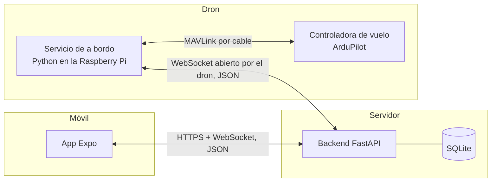
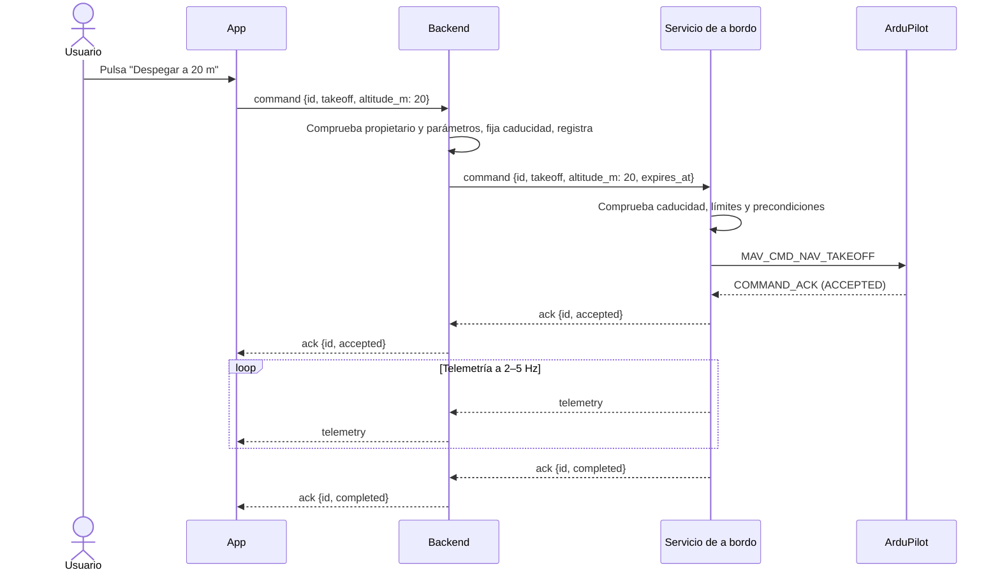

# Drone Manager

Aplicación para gestionar y comandar drones con ArduPilot desde el móvil: dar de alta tus drones, ver su estado en tiempo real y mandarles órdenes (despegar, moverse, ir a un punto, aterrizar, seguirte con el GPS del teléfono).

Proyecto candidato a Trabajo Fin de Grado de Ingeniería del Software.

> **Estado:** fase de diseño. El desarrollo y las pruebas se hacen en simulación (ArduCopter SITL + Gazebo); todavía no hay hardware físico.

## Componentes

| Componente | Tecnología | Dónde se ejecuta | Responsabilidad |
|---|---|---|---|
| App | Expo / React Native (TypeScript) | Móvil | Interfaz: drones, estado en tiempo real y órdenes |
| Backend | FastAPI + SQLite | Servidor (en desarrollo, el PC) | Usuarios, drones, autenticación, reenvío y registro de órdenes. Ver [backend/README.md](backend/README.md) |
| Servicio de a bordo | Python + pymavlink | Ordenador de a bordo: Raspberry Pi 4/5 (en simulación, el PC) | Traduce órdenes a MAVLink, vigila la seguridad y envía telemetría |
| Controladora de vuelo | ArduPilot (ArduCopter) | Placa del dron (en simulación, SITL) | Estabiliza, mueve los motores y navega |

## Arquitectura



### ¿Por qué hace falta un ordenador de a bordo?

La controladora de vuelo es un microcontrolador que ejecuta ArduPilot: estabiliza el dron cientos de veces por segundo, pero **solo entiende MAVLink por un cable (puerto serie) o por una radio**. No puede conectarse a internet, no habla WebSocket ni MQTT y no puede ejecutar nuestro código.

Por eso el dron lleva un pequeño ordenador, una Raspberry Pi, conectado por cable a la controladora. En él corre el **servicio de a bordo**: un programa Python que hace lo mismo que los scripts de prueba con pymavlink (conectarse, armar, despegar…), pero en vez de seguir una secuencia fija, recibe las órdenes del backend y le devuelve el estado del dron.

Es el dron quien abre la conexión con el backend, y no al revés. Así funciona desde cualquier red, incluida una red móvil detrás de NAT, donde no se puede conectar con el dron desde fuera.

En simulación, la arquitectura es la misma y solo cambia la configuración:

| Componente | Simulación | Dron real |
|---|---|---|
| Controladora de vuelo | ArduCopter SITL (+ Gazebo) en el PC | Placa con ArduPilot |
| Servicio de a bordo | En el PC, o en la Raspberry Pi conectada por red al PC | En la Raspberry Pi |
| Conexión MAVLink | `udp:127.0.0.1:14550` | Puerto serie, p. ej. `/dev/serial0` |

### Flujo de una orden



### Principios de diseño

1. **El backend no habla MAVLink.** Solo conoce acciones de alto nivel; la traducción a MAVLink vive en el servicio de a bordo.
2. **La seguridad del vuelo no depende de la red.** Si se pierde la conexión, el dron se protege solo: failsafes de ArduPilot más la capa de seguridad del servicio de a bordo.
3. **Toda orden recibe respuesta y caduca.** Se acepta, se rechaza, se completa, falla o caduca, siempre en un tiempo acotado. Una orden que llega tarde no se ejecuta.
4. **El control manual tiene hombre muerto.** Si el dron deja de recibir el aviso de "sigo pulsando", se para.
5. **El mismo código en simulación y en el dron real.** Solo cambia la configuración.

El catálogo de acciones, el control manual, las prioridades y el formato de los mensajes están en [docs/acciones-y-protocolo.md](docs/acciones-y-protocolo.md).

## Requisitos

### Requisitos generales

La aplicación tiene como propósito general gestionar y comandar drones con ArduPilot desde el móvil. El backend guarda los datos de forma permanente y hace de puente entre la app y el dron; el ordenador de a bordo traduce las órdenes a MAVLink ([ADR-001](docs/decisiones.md#adr-001--ordenador-de-a-bordo-que-se-conecta-al-backend)).

### Requisitos funcionales

- **RF1:** Como usuario quiero poder añadir mis drones a la aplicación para poder gestionarlos de forma eficiente.
- **RF2:** Como usuario quiero poder cambiar la información de mi dron para adaptarlo a mis gustos y necesidades.
- **RF3:** Como usuario quiero poder comandar mi dron desde el móvil para usarlo de forma más fácil y eficiente.
- **RF4:** Como usuario quiero poder tener varias opciones automáticas de vuelo para comandar al dron con menos esfuerzo.
- **RF5:** Como usuario quiero poder registrarme e iniciar sesión para que mis drones sean solo míos.
- **RF6:** Como usuario quiero poder eliminar un dron para mantener mi lista ordenada.
- **RF7:** Como usuario quiero poder regenerar la clave de un dron para recuperar el control si creo que se ha filtrado.
- **RF8:** Como usuario quiero ver si mi dron está en línea para saber si puedo comandarlo.
- **RF9:** Como usuario quiero que el dron me siga usando el GPS de mi móvil para que me acompañe sin tener que pilotarlo. *(Primera opción automática de RF4.)*
- **RF10:** Como usuario quiero ver en tiempo real la posición, altura, batería y modo de vuelo de mi dron para saber en qué estado está.
- **RF11:** Como usuario quiero saber si cada orden se ha aceptado, completado o ha fallado, y por qué, para poder reaccionar a tiempo.
- **RF12:** Como usuario quiero consultar el historial de órdenes de mi dron para revisar lo que ha pasado en un vuelo.

### Requisitos no funcionales

- **RNF1 (latencia):** objetivos provisionales, medidos en red local y a validar con medidas reales:
  - Control manual: menos de 200 ms de punta a punta.
  - Órdenes discretas (despegar, ir a un punto…): menos de 1 s hasta recibir la aceptación.
  - Telemetría en la app: al menos 2 actualizaciones por segundo.
- **RNF2 (credenciales):** las credenciales del usuario deben ser seguras y **revocables**. Quien robe el token de un usuario controla los drones de ese usuario, por lo que un token robado debe poder invalidarse sin esperar a que caduque.
- **RNF3 (fiabilidad):** cada orden recibe confirmación y termina en un estado final (completada, fallida, rechazada, caducada o cancelada) en un tiempo acotado. Si el dron deja de recibir órdenes de movimiento durante un tiempo corto, se detiene por sí solo; si pierde la conexión con el backend de forma prolongada, vuelve al punto de despegue.
- **RNF4 (clave del dron):** la clave de cada dron debe ser única, aleatoria, no recuperable desde la base de datos y regenerable. Quien la robe puede hacerse pasar por ese dron.
- **RNF5 (portabilidad):** el servicio de a bordo funciona sin cambios de código en simulación y en la Raspberry Pi; solo cambia la configuración.
- **RNF6 (verificabilidad):** cada acción del catálogo tiene tests automáticos que se ejecutan contra SITL.
- **RNF7 (extensibilidad):** añadir una acción o un comportamiento autónomo (por ejemplo, una futura red neuronal) se hace ampliando el catálogo, sin cambiar la arquitectura.

## Decisiones de arquitectura

Detalle (contexto, alternativas y consecuencias) en [docs/decisiones.md](docs/decisiones.md).

| ADR | Decisión | Estado |
|---|---|---|
| 001 | Ordenador de a bordo que se conecta al backend y traduce a MAVLink | Aceptada |
| 002 | Órdenes de alto nivel con un catálogo cerrado de acciones | Aceptada |
| 003 | Control manual con hombre muerto | Aceptada |
| 004 | La seguridad del vuelo reside en el dron | Aceptada |
| 005 | WebSocket como transporte inicial, un solo proceso de backend | Aceptada |
| 006 | Sesión con token de acceso corto y renovación revocable; clave propia por dron | Aceptada |
| 007 | SQLite + SQLModel; la telemetría no se guarda | Aceptada |
| 008 | Fotos en base64 dentro del JSON, guardadas en disco | Aceptada |
| 009 | Seguimiento como comportamiento propio en modo GUIDED | Aceptada |
| 010 | Versión estable y fija de ArduCopter | Aceptada |
| 011 | La red neuronal queda fuera del alcance inicial | Aceptada |
| 012 | Control manual con consignas de velocidad en modo GUIDED | Aceptada |
| 013 | Parada de emergencia | Propuesta |

## Hoja de ruta

| Fase | Contenido |
|---|---|
| **0. Base** | Monorepo con git. Servicio de a bordo con conexión, estado y acciones básicas (armar, despegar, aterrizar, ir a un punto), con tests contra SITL. Se corrigen los problemas detectados en los scripts de prueba. |
| **1. Backend** | Autenticación, gestión de drones, reenvío de órdenes y telemetría por WebSocket, historial de órdenes. |
| **2. App** | Inicio de sesión, lista de drones, pantalla de vuelo con telemetría, botones de órdenes y control manual, seguimiento con el GPS del móvil. |
| **3. Hardware** | (a) Servicio de a bordo en la Raspberry Pi con SITL en el PC, por red. (b) Raspberry Pi con la controladora real, en banco y sin hélices. (c) Vuelo real. |
| **Trabajo futuro** | Red neuronal (mapa del entorno, seguimiento visual), vídeo (WebRTC), conexión 4G, MQTT, despliegue en la nube. |

## Estructura del repositorio

Situación actual:

```
Piloto/
├── ardupilot/              # ArduPilot, para ejecutar SITL
├── Scripts/1. Testeos/     # scripts de prueba con pymavlink
└── drone-manager/
    ├── README.md           # este documento
    ├── docs/               # decisiones y protocolo
    ├── backend/            # de momento, solo documentación
    └── frontend-trial/     # prototipo de la app Expo
```

Estructura objetivo (fase 0):

```
drone-manager/
├── app/          # app Expo (lo que hoy es frontend-trial)
├── backend/      # FastAPI
├── onboard/      # servicio de a bordo
├── protocol/     # modelos Pydantic compartidos: acciones y mensajes
└── docs/
```

## Glosario

- **ADR** (*Architecture Decision Record*): registro de una decisión de arquitectura con su contexto y sus consecuencias.
- **ArduPilot / ArduCopter:** firmware de autopiloto de código abierto; ArduCopter es su versión para multirrotores.
- **ACK:** confirmación de que una orden se ha recibido, y si se acepta o se rechaza.
- **Controladora de vuelo:** placa dentro del dron que ejecuta ArduPilot.
- **Failsafe:** comportamiento automático de seguridad ante un fallo (pérdida de enlace, batería baja…).
- **Geovalla:** límite geográfico que el dron no puede cruzar.
- **GUIDED:** modo de vuelo de ArduPilot en el que el dron obedece órdenes externas (puntos, velocidades).
- **Hombre muerto:** mecanismo que detiene una acción si el operador deja de confirmar activamente que quiere seguir.
- **MAVLink:** protocolo de mensajes binarios entre controladoras de vuelo y estaciones de tierra.
- **Ordenador de a bordo:** la Raspberry Pi montada en el dron.
- **RTL** (*Return To Launch*): volver al punto de despegue y aterrizar.
- **Servicio de a bordo:** nuestro programa Python que corre en el ordenador de a bordo.
- **SITL** (*Software In The Loop*): ArduPilot ejecutándose en el PC con un dron simulado; Gazebo añade el mundo en 3D.
