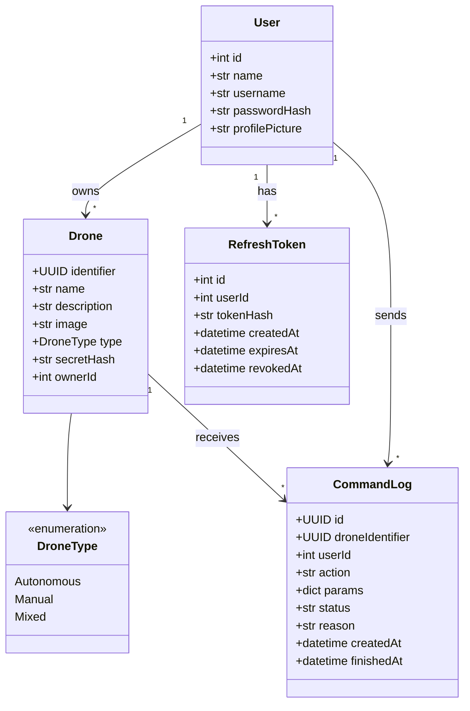

# Backend

Servidor FastAPI de Drone Manager. La visión general, la arquitectura y los requisitos están en el [README principal](../README.md); las decisiones, en [docs/decisiones.md](../docs/decisiones.md).

El backend de nuestra aplicación se encarga de:

- Gestionar los datos de la base de datos.
- Autenticar a los usuarios y limitar a cada uno a sus propios drones.
- Reenviar las órdenes de la app al dron y el estado del dron a la app. **No habla MAVLink:** la traducción la hace el servicio de a bordo ([ADR-001](../docs/decisiones.md#adr-001--ordenador-de-a-bordo-que-se-conecta-al-backend)).
- Validar cada orden (propietario, acción y parámetros) y guardarla en el historial.
- Mantener la conexión en tiempo real entre la app y el dron.

## Modelo de datos



- `User.username` es único y es lo que se usa para iniciar sesión; `name` es el nombre para mostrar.
- `Drone.identifier` es público y es la clave primaria. `secretHash` es el hash de la clave secreta del dron; la clave en claro nunca se guarda.
- `Drone.ownerId` es el usuario propietario; lo fija el servidor a partir de la sesión, nunca el cliente.
- `RefreshToken` guarda el hash de cada token de renovación, no el token. Al renovar, el token usado se marca como revocado (`revokedAt`) y se crea otro; cerrar sesión revoca el actual ([ADR-006](../docs/decisiones.md#adr-006--sesión-con-token-de-acceso-corto-y-renovación-revocable-clave-propia-por-dron)).
- `image` y `profilePicture` guardan la ruta del archivo, no la imagen.
- El estado "en línea" de un dron **no se guarda**: se deduce de las conexiones activas en cada momento.
- `CommandLog` guarda cada orden con el mismo `id` que viaja en el mensaje y su estado final (RF11, RF12). Los mensajes de control manual (`move`) no se registran uno a uno, porque llegan cada 200 ms.
- La telemetría no se guarda, solo se reenvía ([ADR-007](../docs/decisiones.md#adr-007--sqlite--sqlmodel-la-telemetría-no-se-guarda)).

## Requisitos

Los requisitos son del sistema completo y están en el [README principal](../README.md#requisitos).

## Stack tecnológico

Dependencias, protocolos, librerías y frameworks.

### Websockets

Para comandar al dron de forma rápida, efectiva y con poca latencia usamos websockets, que mantienen un canal abierto con comunicación en los dos sentidos: órdenes hacia el dron y estado hacia la app. Una alternativa es MQTT, muy usada en IoT ([ADR-005](../docs/decisiones.md#adr-005--websocket-como-transporte-inicial-un-solo-proceso-de-backend)).

### FastAPI + uvicorn

FastAPI soporta websockets de forma nativa, valida las entradas con tipos de Python (Pydantic) y genera `/docs`, que sirve para probar los endpoints sin la app.

Uvicorn es el servidor en el que se ejecuta. Se instala como `uvicorn[standard]` para incluir la librería de websockets; sin ella los endpoints `/ws/...` fallan.

Nota: la sesión de base de datos es síncrona, por lo que los endpoints REST se declaran con `def` normal (FastAPI los ejecuta en un hilo aparte) para no bloquear el bucle de eventos.

### Capa de datos: SQLite + SQLModel

SQLite es la forma más sencilla de almacenar los datos: un archivo, sin servidor. En un despliegue más serio se migra a PostgreSQL o MariaDB.

SQLModel es una capa fina sobre SQLAlchemy: con una clase se define tabla y esquema. Si hace falta más complejidad, se baja a SQLAlchemy como ORM.

Para no exponer campos que controla el servidor, las clases se separan por capas:

```python
class DroneBase(SQLModel):                 # lo que rellena el usuario
    name: str = Field(min_length=1, max_length=50)
    description: str = Field(default="", max_length=500)
    type: DroneType

class Drone(DroneBase, table=True):        # lo que se guarda
    identifier: uuid.UUID = Field(default_factory=uuid.uuid4, primary_key=True)
    owner_id: int = Field(foreign_key="user.id", index=True)
    secret_hash: str
    image: str | None = None

class DroneCreate(DroneBase):              # lo que acepta POST /drones
    photo_base64: str | None = Field(default=None, max_length=1_500_000)
```

El cliente nunca puede fijar `identifier`, `owner_id` ni `secret_hash`: los pone el servidor, el propietario a partir del token de sesión. `DroneType` se define como `class DroneType(str, Enum)` para que viaje como texto en el JSON.

### Autenticación: bcrypt + JWT

**bcrypt** se usa para hashear las contraseñas de los usuarios.

**JWT** es un token firmado que el servidor puede verificar sin consultar la base de datos. Su limitación es que no se puede revocar antes de que caduque: si se roba un token de 7 días, es válido durante 7 días. En este contexto es una decisión crítica, porque lo último que queremos es que alguien robe un token y controle un dron.

Decisión (aceptada el 2026-11-10, [ADR-006](../docs/decisiones.md#adr-006--sesión-con-token-de-acceso-corto-y-renovación-revocable-clave-propia-por-dron)):

- **Token de acceso corto** (unos 15 minutos) más un **token de renovación** guardado en la base de datos, que sí puede revocarse.
- **Websocket de la app:** la app pide por HTTP autenticado un *ticket* de un solo uso y lo presenta al conectarse, de modo que el token real no viaja en la URL.

Hay **dos credenciales distintas** con riesgos distintos:

| Credencial | Conexión | Qué protege |
|---|---|---|
| Token del usuario (JWT) | app ↔ backend | los drones de ese usuario |
| Clave del dron | dron ↔ backend | la identidad de ese dron |

#### Alta de un dron y clave

1. El usuario registra el dron desde la app con un formulario (`name`, `description`, `type`, foto). El formulario no incluye ni `identifier` ni la clave.
2. El servidor genera el `identifier` (UUID) y una clave secreta aleatoria (`secrets.token_urlsafe(32)`). Guarda solo el hash de la clave y la devuelve **una única vez** en esa respuesta.
3. El usuario copia identificador y clave en el dron (o en su ordenador de a bordo).
4. El dron se conecta a `/ws/drone/{identifier}` presentando la clave en una cabecera `Authorization`, no en la URL.
5. **Regenerar clave** crea una nueva, invalida la anterior y corta la conexión actual del dron.

A diferencia de las contraseñas de usuario (que elige una persona y son débiles, por eso bcrypt), la clave del dron es aleatoria y larga, así que basta un SHA-256, comparado con `hmac.compare_digest` para evitar ataques de temporización.

### Fotos: base64 en el JSON + archivos en disco

La foto se envía como texto (base64) dentro del mismo objeto JSON que el resto del formulario, así que no hace falta multipart ni `python-multipart`. En la app, `expo-image-picker` devuelve la imagen ya en base64 (`base64: true`), con lo que el código es idéntico en web y en móvil.

El backend decodifica la imagen, la guarda en `media/` con un nombre aleatorio (UUID) y solo almacena la ruta en la base de datos (`image`). Reglas:

- Se reduce la foto en el cliente (`quality: 0.5`) y se limita el tamaño en el esquema (`max_length`).
- La API **nunca devuelve el base64**, solo la URL.
- Más adelante se validará con Pillow que los bytes son una imagen real y se tomará el formato de ahí, no de lo que diga el cliente.
- No se admite SVG, porque puede contener scripts.

## Protocolo de websockets

El protocolo completo (acciones, control manual, confirmaciones y telemetría) está en [docs/acciones-y-protocolo.md](../docs/acciones-y-protocolo.md). Resumen:

| Canal | Quién | Autenticación |
|---|---|---|
| `/ws/control/{identifier}` | la app (operador) | ticket de un solo uso |
| `/ws/drone/{identifier}` | el servicio de a bordo | clave del dron |

| Mensajes | Sentido |
|---|---|
| `command` (acciones como `takeoff`, `goto`, `land`, `follow`…) | app → dron, con respuesta `ack` |
| `move`, `stop` (control manual) | app → dron |
| `target_position` (posición del móvil durante `follow`) | app → dron |
| `ack`, `telemetry` | dron → app |
| `status` (en línea / desconectado) | backend → app |

El backend no interpreta las órdenes más allá de validarlas. Comprueba que el dron es del usuario, que la acción existe y que los parámetros son válidos, añade la caducidad (`expires_at`), registra la orden y la reenvía.

**Control manual:** `dir` puede ser `forward`, `back`, `left`, `right`, `up` o `down`. Mientras el botón está pulsado, la app repite `{ "type": "move", "dir": "...", "active": true }` cada 200 ms, y manda `active: false` al soltarlo. Cada `move` lleva `sent_at`, y el backend descarta los que tengan más de 500 ms ([ADR-003](../docs/decisiones.md#adr-003--control-manual-con-hombre-muerto)).

**Seguridad:** si el operador se desconecta, el servidor manda `stop` al dron. Además, el servicio de a bordo anula cualquier dirección que no se repita en 500 ms y, si pierde el backend en vuelo, mantiene la posición y luego vuelve a casa ([ADR-004](../docs/decisiones.md#adr-004--la-seguridad-del-vuelo-reside-en-el-dron)).

## Decisiones pendientes

Resueltas (ver [docs/decisiones.md](../docs/decisiones.md)):

- Comunicación con el dron: ordenador de a bordo que se conecta al backend (ADR-001).
- Base de datos: SQLite por ahora (ADR-007).
- Hub en memoria: un solo proceso de uvicorn; Redis o MQTT si hace falta escalar (ADR-005).
- Sesión del usuario: token de acceso corto más renovación revocable (ADR-006).

Abiertas:

- **Latencia objetivo** (RNF1): fijar la cifra definitiva tras medir.
- **Un operador o varios por dron:** hoy el hub permite varios; para control manual probablemente convenga uno solo activo.
- **`DroneType`:** *Autonomous / Manual / Mixed* describe cómo se vuela, no qué es el dron; el mismo ArduCopter vuela de las tres formas. ¿Lo sustituimos por el tipo de vehículo (multirrotor, avión, rover) o tiene otro uso en la app?

## Antes de producción

- Limitar CORS al dominio real (en desarrollo está abierto).
- Definir `JWT_SECRET` como variable de entorno; no usar el valor por defecto.
- Usar HTTPS y `wss://`.
- Limitar el tamaño del cuerpo de las peticiones en el proxy inverso.

## Ejecución en desarrollo

```bash
pip install fastapi "uvicorn[standard]" sqlmodel pyjwt bcrypt
uvicorn main:app --reload --host 0.0.0.0
```

La documentación interactiva de la API queda en `http://localhost:8000/docs`.