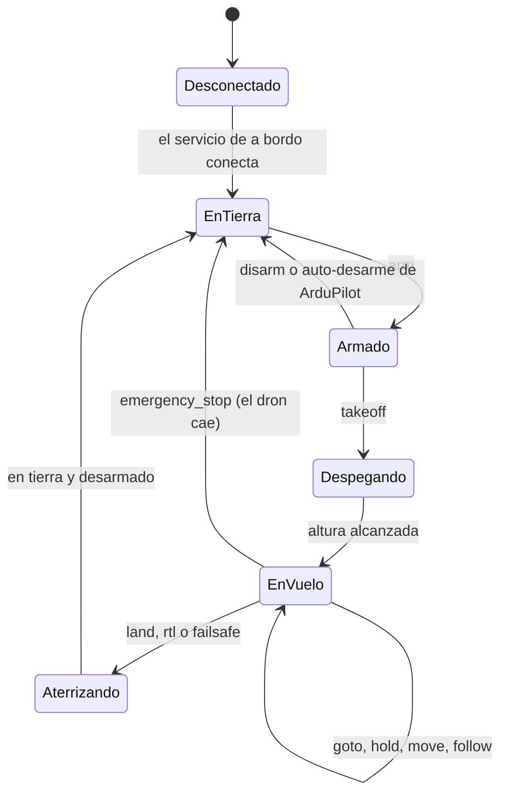

# Catálogo de acciones y protocolo

Qué puede hacer el dron, en qué condiciones y cómo viajan las órdenes entre la app, el backend y el servicio de a bordo. Decisiones relacionadas: [ADR-002](decisiones.md#adr-002--órdenes-de-alto-nivel-con-un-catálogo-cerrado-de-acciones), [ADR-003](decisiones.md#adr-003--control-manual-con-hombre-muerto) y [ADR-004](decisiones.md#adr-004--la-seguridad-del-vuelo-reside-en-el-dron).

> Las cifras (tiempos, distancias, velocidades) son valores iniciales y se ajustarán con las pruebas en SITL.

## Tipos de orden

| Tipo | Ejemplo | Confirmación |
|---|---|---|
| **Acción** (orden discreta) | despegar a 20 m | Sí: `ack` con estado |
| **Control manual** | mantener pulsado "adelante" | No: hombre muerto |
| **Comportamiento** (continuo) | seguir al móvil | Sí, al iniciarlo y al terminar |

## Acciones

Cada acción define sus parámetros, sus **precondiciones** (que el servicio de a bordo comprueba antes de mandar nada a ArduPilot, aunque ArduPilot puede rechazarla igualmente), su **condición de fin** y su **tiempo máximo**. En el código, cada acción es una clase (patrón Command) con un modelo Pydantic para sus parámetros.

| Acción | Parámetros | Precondiciones | Termina cuando | Tiempo máx. |
|---|---|---|---|---|
| `arm` | — | En tierra y desarmado | La controladora informa de motores armados | 10 s |
| `disarm` | — | En tierra | Motores desarmados | 5 s |
| `takeoff` | `altitude_m` | Armado y en tierra; `0 < altitude_m ≤` altura máxima | Altura ≥ 95 % del objetivo | Proporcional a la altura |
| `goto` | `lat`, `lon`, `altitude_m` | En vuelo; destino dentro de la geovalla | A menos de 2 m del destino | Proporcional a la distancia |
| `set_speed` | `speed_m_s` | En vuelo; `0 < speed_m_s ≤` velocidad máxima | La controladora confirma | 3 s |
| `hold` | — | En vuelo | Velocidad ≈ 0 | 5 s |
| `land` | — | En vuelo | En tierra y desarmado | Proporcional a la altura |
| `rtl` | — | En vuelo | En tierra y desarmado en el punto de despegue | Proporcional a la distancia |
| `emergency_stop` | — | Ninguna | Motores desarmados | 3 s |

> ⚠️ `emergency_stop` para los motores al instante, también en vuelo: **el dron cae**. Es la última salida cuando `land` o `hold` no sirven ([ADR-013](decisiones.md#adr-013--parada-de-emergencia)). La app exige mantener pulsado el botón.

Las acciones que lo necesitan ponen el dron en modo GUIDED antes de ejecutarse, salvo que esté en un modo de seguridad (ver [Prioridades](#prioridades)).

## Control manual

Corresponde a las flechas de la pantalla del dron: adelante, atrás, izquierda, derecha, subir y bajar.

```json
{ "type": "move", "dir": "forward", "active": true,  "sent_at": "2026-10-09T18:30:01.200Z" }
{ "type": "move", "dir": "forward", "active": false, "sent_at": "2026-10-09T18:30:02.000Z" }
{ "type": "stop" }
```

- **Mientras el botón esté pulsado, la app repite el mensaje `active: true` cada 200 ms.** Al soltarlo, manda `active: false`.
- El servicio de a bordo convierte las direcciones activas en una consigna de velocidad (por defecto 1 m/s; adelante y atrás son relativos al morro del dron). Se pueden combinar, por ejemplo adelante y subir a la vez.
- **Hombre muerto:** si una dirección no se repite en 500 ms, se anula. Si no queda ninguna, el dron se detiene.
- `stop` anula todas las direcciones y detiene el dron al momento.
- **Mensajes atrasados:** `sent_at` es la hora del servidor en el momento de enviar (la app calcula su desfase con el `welcome` que recibe al conectar). El backend y el servicio de a bordo descartan cualquier `move` con más de 500 ms de antigüedad, para que una ráfaga de mensajes retenidos por un corte de red no mueva el dron a destiempo. `stop` no lleva `sent_at` y nunca se descarta.
- Requiere que el dron esté en vuelo. Cancela cualquier acción o comportamiento en curso.

### Traducción a MAVLink

Las flechas funcionan como un mando digital: el servicio de a bordo las convierte en una **consigna de velocidad en los ejes del dron** y la manda con `SET_POSITION_TARGET_LOCAL_NED` en modo GUIDED ([ADR-012](decisiones.md#adr-012--control-manual-con-consignas-de-velocidad-en-modo-guided)).

| `dir` | `vx` (morro) | `vy` (derecha) | `vz` (abajo) |
|---|---|---|---|
| `forward` / `back` | `+v` / `−v` | 0 | 0 |
| `right` / `left` | 0 | `+v` / `−v` | 0 |
| `up` / `down` | 0 | 0 | `−vz` / `+vz` |

- `coordinate_frame = MAV_FRAME_BODY_OFFSET_NED` (9) y `type_mask = 0x05C7` (solo velocidad y velocidad de giro). `v` = 1 m/s y `vz` = 0,5 m/s por defecto.
- Las direcciones activas se suman en una sola consigna, que se reenvía a 5 Hz mientras quede alguna activa.
- Cuando no queda ninguna, se manda velocidad cero: el dron frena y mantiene la posición.
- Si el servicio de a bordo dejara de mandar consignas, ArduPilot detiene el dron a los `GUID_TIMEOUT` segundos.

## Comportamientos

Un comportamiento corre de forma continua: lee el estado del dron y manda consignas a la controladora a 5 Hz como máximo, hasta que termina o se cancela. Una futura red neuronal sería un comportamiento más ([ADR-011](decisiones.md#adr-011--la-red-neuronal-queda-fuera-del-alcance-inicial)).

### `follow`: seguir un objetivo

| Parámetro | Por defecto | Descripción |
|---|---|---|
| `distance_m` | 5 | Distancia mínima al objetivo. No baja de 5 m porque el GPS del móvil tiene unos 5 m de error. |
| `altitude_m` | 10 | Altura de seguimiento. |

- **Precondiciones:** en vuelo.
- **Origen del objetivo:** mientras dure el seguimiento, la app envía su posición una vez por segundo con `target_position`. En pruebas, el origen puede ser `walk_sim`.
- **Si el objetivo deja de actualizarse durante 3 s**, el dron mantiene la posición.
- **Termina** con cualquier orden del operador o con un evento de seguridad.

## Prioridades

1. **Seguridad**, que siempre gana: failsafes de ArduPilot y límites del servicio de a bordo.
2. **Operador**: órdenes y control manual desde la app.
3. **Comportamiento autónomo**: seguimiento y, en el futuro, la red neuronal.

Reglas:

- Solo hay **una orden activa por dron**. Una orden nueva del operador cancela la anterior, que termina en estado `cancelled`.
- Mientras haya un failsafe activo (por ejemplo, vuelta a casa por batería baja), solo se aceptan `land`, `rtl` y `emergency_stop`.

## Seguridad en el servicio de a bordo

| Mecanismo | Valor inicial |
|---|---|
| HEARTBEAT a la controladora; si deja de llegar, actúa el failsafe de ArduPilot (`FS_GCS_ENABLE`) | 1 Hz |
| Altura máxima (límite de la categoría abierta en la UE) | 120 m |
| Distancia máxima al punto de despegue | Configurable; también como geovalla en ArduPilot (`FENCE_*`) |
| Velocidad máxima | Configurable |
| Pérdida del backend en vuelo | 5 s: mantener posición. 30 s: volver a casa |
| Hombre muerto del control manual | 500 ms |
| Antigüedad máxima de un `move` (`sent_at`) | 500 ms |
| Parada de ArduPilot si no recibe consignas de velocidad (`GUID_TIMEOUT`) | 1 s |
| Frecuencia máxima de consignas a la controladora | 5 Hz |
| Batería baja | La gestiona ArduPilot (`BATT_FS_*`); el servicio la refleja en la telemetría |

## Mensajes

Todos los mensajes son JSON sobre WebSocket. El dron se identifica por la URL del canal, así que los mensajes no repiten su identificador.

| Canal | Quién se conecta | Autenticación |
|---|---|---|
| `/ws/control/{identifier}` | La app (operador) | Ticket de un solo uso |
| `/ws/drone/{identifier}` | El servicio de a bordo | Clave del dron en la cabecera `Authorization` |

| Mensaje | Sentido | Para qué |
|---|---|---|
| `welcome` | backend → dron y backend → app | Al conectar: hora del servidor, para calcular el desfase de reloj |
| `command` | app → backend → dron | Acción o comportamiento |
| `move`, `stop` | app → backend → dron | Control manual |
| `target_position` | app → backend → dron | Posición del objetivo durante `follow` |
| `ack` | dron → backend → app | Estado de una orden |
| `telemetry` | dron → backend → app | Estado del dron, de 2 a 5 Hz |
| `status` | backend → app | Dron en línea o desconectado |

### `command`

La app genera el `id` (un UUID) para poder relacionar la orden con sus respuestas. El backend añade `expires_at` antes de reenviarla, por defecto 5 s después de recibirla.

```json
{
  "type": "command",
  "id": "5f0c2a9e-4c1b-4f7e-9a51-2d7b8f3c1e44",
  "action": "takeoff",
  "params": { "altitude_m": 20 },
  "expires_at": "2026-10-09T18:30:05Z"
}
```

`expires_at` usa la hora del servidor. El servicio de a bordo calcula su desfase con el servidor gracias a `welcome`, así que no depende de que el reloj de la Raspberry Pi esté en hora.

### `ack`

```json
{ "type": "ack", "id": "5f0c2a9e-…", "status": "rejected", "reason": "PRECONDITION_FAILED", "detail": "El dron no está armado" }
```

| `status` | Significado | ¿Final? |
|---|---|---|
| `accepted` | Precondiciones correctas y ArduPilot la ha aceptado (ver abajo) | No |
| `completed` | Se ha alcanzado la condición de fin | Sí |
| `rejected` | La rechaza el backend, el servicio de a bordo o ArduPilot | Sí |
| `failed` | Error o tiempo máximo agotado durante la ejecución | Sí |
| `expired` | Llegó al dron después de `expires_at` | Sí |
| `cancelled` | La sustituyó otra orden o un evento de seguridad | Sí |

**Qué significa "ArduPilot la ha aceptado":** el servicio de a bordo traduce cada acción a un comando MAVLink y espera su `COMMAND_ACK` con resultado `MAV_RESULT_ACCEPTED`. Si el resultado es otro, o no llega en 2 s, la orden termina en `rejected` con `AUTOPILOT_REJECTED`.

| Acción | Comando MAVLink | Se da por aceptada cuando |
|---|---|---|
| `arm`, `disarm`, `emergency_stop` | `MAV_CMD_COMPONENT_ARM_DISARM` | Llega el `COMMAND_ACK` |
| `takeoff` | `MAV_CMD_NAV_TAKEOFF` | Llega el `COMMAND_ACK` |
| `goto` | `MAV_CMD_DO_REPOSITION` (en `COMMAND_INT`) | Llega el `COMMAND_ACK` |
| `set_speed` | `MAV_CMD_DO_CHANGE_SPEED` | Llega el `COMMAND_ACK` |
| `hold`, `land`, `rtl` | `MAV_CMD_DO_SET_MODE` | Llega el `COMMAND_ACK` y el `HEARTBEAT` muestra el modo nuevo |

`goto` usa `MAV_CMD_DO_REPOSITION` y no `SET_POSITION_TARGET_GLOBAL_INT` precisamente porque la consigna de posición no tiene confirmación. El control manual y `follow` sí usan consignas sin `COMMAND_ACK`; por eso no tienen estado `accepted` por consigna y se protegen con el hombre muerto.

Valores de `reason`:

- **Puestos por el backend:** `NOT_OWNER`, `DRONE_OFFLINE`, `INVALID_PARAMS`.
- **Puestos por el servicio de a bordo:** `PRECONDITION_FAILED`, `OUT_OF_LIMITS`, `AUTOPILOT_REJECTED`, `FAILSAFE_ACTIVE`.

### `telemetry`

```json
{
  "type": "telemetry",
  "ts": "2026-10-09T18:30:01.200Z",
  "lat": 36.508472, "lon": -6.281327, "rel_alt_m": 19.6,
  "ground_speed_m_s": 0.4, "heading_deg": 87,
  "mode": "GUIDED", "armed": true, "landed": false,
  "battery_pct": 78, "gps_fix": 3,
  "active_command": "5f0c2a9e-…"
}
```

### `target_position`

```json
{ "type": "target_position", "lat": 36.50851, "lon": -6.28129, "accuracy_m": 4.5, "ts": "2026-10-09T18:30:01Z" }
```

## Estados del dron



Si el servicio de a bordo pierde la conexión con el backend, la app muestra el dron como desconectado, pero el dron sigue en su estado real. Mientras está en vuelo, aplica las reglas de [pérdida del backend](#seguridad-en-el-servicio-de-a-bordo).
