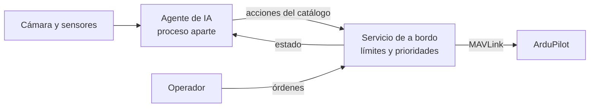

# Idea: agente de IA a bordo

> **Estado: idea de planteamiento.** El dron aún se está desarrollando y esto no forma parte del alcance. Amplía el punto de extensión que ya deja previsto [ADR-011](decisiones.md#adr-011--la-red-neuronal-queda-fuera-del-alcance-inicial). No se ha investigado a fondo: recoge lo necesario para no cerrarle la puerta.

**Sobre el nombre.** "Agente de IA" es aquí un programa que percibe el entorno y decide por su cuenta qué órdenes dar. No es el **servicio de a bordo**, que es el programa que traduce órdenes a MAVLink y vigila la seguridad. Son dos piezas distintas y la segunda manda sobre la primera.

## Dónde encaja

Es un **comportamiento** más, como `follow` (ver [acciones-y-protocolo.md](acciones-y-protocolo.md#comportamientos)):

- Lee el estado del dron y sus sensores.
- Emite **acciones del catálogo**, no MAVLink.
- Tiene la prioridad más baja: seguridad > operador > comportamiento autónomo. Cualquier orden del operador lo cancela.
- Pasa por los mismos límites que todo lo demás (altura, distancia, velocidad, geovalla).

## Reglas que lo hacen viable

1. **Proceso separado.** Si el agente se cuelga, se queda sin memoria o tarda diez segundos en pensar, el servicio de a bordo sigue funcionando. Habla con él por un canal local, con el mismo formato de mensajes que el backend.
2. **El agente no es de fiar, y no hace falta que lo sea.** La seguridad no depende de que acierte: la garantizan los límites del servicio de a bordo y los failsafes de ArduPilot. Es la misma idea que con la voz.
3. **Hombre muerto para el agente.** Si deja de dar señales, el servicio de a bordo cancela su comportamiento y mantiene posición.
4. **Nunca cierra el lazo de control.** Decide a dónde ir, no cómo mover los motores. Eso es de ArduPilot.
5. **Todo lo que hace queda en el historial**, con `source: autonomous`.

## Dos velocidades

Un modelo de lenguaje o de visión y lenguaje tarda del orden de segundos por decisión en hardware de a bordo. No sirve para reaccionar. Lo razonable es separar:

| Capa | Qué hace | Frecuencia | Tecnología |
|---|---|---|---|
| Percepción rápida | Detectar y seguir objetos, estimar distancias | 10–30 veces por segundo | Redes de visión clásicas, con acelerador |
| Decisión lenta | Elegir el siguiente objetivo, interpretar una misión | Una vez cada pocos segundos | Modelo de lenguaje pequeño, o reglas |
| Control | Estabilizar y navegar | Cientos de veces por segundo | ArduPilot |

La capa rápida puede alimentar directamente a un comportamiento tipo `follow` (el objetivo deja de ser el GPS del móvil y pasa a ser lo que ve la cámara). La capa lenta es la parte "agente".

## Hardware

| Opción | Sirve para | Notas |
|---|---|---|
| Raspberry Pi 5 sola | Decisión lenta con modelos diminutos; visión a pocos fotogramas | Comparte procesador con el servicio de a bordo |
| Pi 5 con AI HAT+ (Hailo-8) | Visión rápida | No acelera modelos de lenguaje |
| Pi 5 con AI HAT+ 2 (Hailo-10H, 8 GB propios) | Visión y modelos de lenguaje pequeños | Las cifras publicadas van de menos de 10 a 30–50 tokens por segundo según quién mida |
| Jetson Orin Nano | Todo lo anterior con más margen | Más consumo, peso y precio |

En un dron pequeño, el peso y el consumo deciden antes que la potencia de cálculo.

## Qué necesita del diseño actual

Lo mismo que la voz, y ya está en [pendientes.md](pendientes.md):

- El servicio de a bordo acepta órdenes de más de un origen, sin asumir que todas vienen del backend ([viabilidad-arquitectura-y-protocolos.md](viabilidad-arquitectura-y-protocolos.md#qué-hace-falta-para-que-c-sea-posible-más-adelante)).
- Campo `source` en las órdenes.
- Catálogo exportado como esquema, que es el espacio de acciones del agente (ADR-002 ya lo dice).
- Acciones de movimiento relativo ([V-14](revision-2026-11-15.md#3-huecos-de-viabilidad)): un agente piensa en "acércate dos metros", no en coordenadas.

## Preguntas abiertas

- ¿Qué tarea concreta haría? Sin un caso de uso (seguir a una persona con la cámara, inspeccionar algo, buscar), no se puede elegir ni modelo ni hardware.
- ¿Cómo se prueba? Gazebo puede simular la cámara, pero evaluar un agente es mucho más difícil que probar una acción.
- ¿Cabe en el TFG, o es la continuación?
