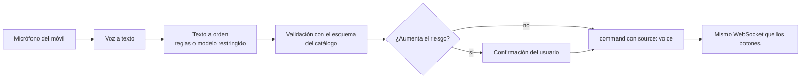

# Idea: órdenes por voz

> **Estado: idea.** No forma parte del alcance ni de la hoja de ruta. Este documento recoge la investigación del 2026-11-15 para saber si es viable y qué habría que respetar hoy para no impedirlo.

La idea: decir "despega a veinte metros" y que el dron lo haga, con un modelo de lenguaje pequeño que corra en el dron o en el navegador y que solo pueda elegir entre las acciones del dron.

## Conclusión

- **Es viable, y la arquitectura actual ya lo permite.** La voz es un cliente más que emite órdenes del catálogo. No toca el backend ni el servicio de a bordo.
- **El modelo debe correr en el móvil o el navegador, no en el dron.** El micrófono tiene que estar donde está la persona, y la Raspberry no debe gastar procesador en esto.
- **Limitar al modelo a las acciones del dron es una técnica estándar** (decodificación restringida) y se alimenta del mismo esquema del catálogo que ya conviene exportar ([V-08](revision-2026-11-15.md#v-08)).
- **Lo primero que hay que probar no lleva modelo de lenguaje**: reconocimiento de voz del sistema y unas reglas. Con nueve acciones, puede bastar, y da la referencia contra la que comparar.
- **Lo difícil no es entender la frase, es no actuar cuando no toca.** El diseño gira en torno a las órdenes falsas.

## Cómo encaja

Todo lo de la izquierda vive en la app. A partir de `command`, el camino es el de siempre: el backend valida y registra, y el servicio de a bordo comprueba precondiciones y límites. **La voz no tiene ningún atajo**: una orden mal entendida se topa con las mismas barreras que un botón pulsado por error.

Lo único que cambia fuera de la app es el campo `source` ([V-17](revision-2026-11-15.md#3-huecos-de-viabilidad)) para que el historial diga que la orden vino por voz.

## Dónde corre cada parte

| Lugar | Voz a texto | Texto a orden | Valoración |
|---|---|---|---|
| **Móvil (app nativa)** | Reconocedor del sistema o Whisper local | Reglas, o modelo local | **Recomendado.** Sin latencia de red, funciona sin cobertura, el audio no sale del móvil |
| **Navegador** | Web Speech API o Whisper con WebGPU | Reglas, modelo con WebGPU o el modelo integrado de Chrome | Viable en escritorio. En móvil depende mucho del navegador |
| **Backend** | Whisper en el servidor | Modelo local o un modelo en la nube | El más sencillo y el de mejor calidad. Añade latencia y sube audio o texto al servidor |
| **Dron (Raspberry)** | No | Posible, pero no recomendado | Solo tendría sentido en modo directo, sin backend |

### Por qué no en el dron

- **El micrófono no puede ir en el dron.** Las hélices hacen mucho ruido y la persona está lejos. El audio se capta en el móvil sí o sí.
- Si el audio ya está en el móvil, mandarlo al dron para interpretarlo es dar un rodeo: lo que debe viajar es la orden ya interpretada, que ocupa unos bytes.
- La Raspberry ejecuta el servicio que vigila la seguridad del vuelo. Un modelo de lenguaje ocupa todos los núcleos durante segundos. Si algún día se hace, tiene que ser otro proceso, con prioridad baja y límite de procesador.
- En una Raspberry Pi 5 sin acelerador, las cifras publicadas para modelos de 1–1,5 mil millones de parámetros rondan los 5–15 tokens por segundo: varios segundos por orden. Los modelos diminutos especializados (abajo) sí irían rápido.

El único caso en que el dron es el sitio correcto es el **modo directo** ([viabilidad-arquitectura-y-protocolos.md](viabilidad-arquitectura-y-protocolos.md#qué-hace-falta-para-que-c-sea-posible-más-adelante)), y aun así el móvil seguiría siendo mejor candidato.

## Reducir el espacio de búsqueda

Se puede limitar en tres puntos, y conviene hacerlo en los tres.

### 1. En el reconocimiento de voz

Decirle al reconocedor qué palabras esperar.

- **Vosk** admite una lista cerrada de frases: el reconocedor solo puede devolver esas palabras o "desconocido". Tiene un modelo pequeño en español de unos 40 MB. Es la forma más literal de "reducir el espacio de búsqueda", y es muy robusta para órdenes fijas. A cambio, no entiende nada fuera de la lista.
- Los reconocedores del sistema (iOS, Android, Chrome) aceptan **frases de contexto** que sesgan el resultado sin cerrarlo. En iOS hay informes de que no funcionan en modo local: hay que probarlo.
- **Whisper** no se puede restringir, pero acepta un texto inicial que lo orienta.

### 2. En la interpretación

Aquí está el modelo de lenguaje, si lo hay. La técnica se llama **decodificación restringida**: en cada paso, el modelo solo puede elegir tokens que mantengan la salida dentro de una gramática. Si la gramática es el esquema JSON del catálogo, **la salida es siempre una orden con la forma correcta**: una acción de la lista y parámetros del tipo adecuado.

- llama.cpp lo hace con gramáticas (GBNF) o directamente con un JSON Schema. Sus adaptaciones para React Native (`llama.rn`) y para navegador incluyen la conversión de esquema a gramática.
- El modelo integrado de Chrome acepta un esquema en la petición (`responseConstraint`).
- Los modelos en la nube tienen el equivalente (salida estructurada, uso de herramientas en modo estricto).

Dos cosas que la gramática **no** garantiza y hay que diseñar:

- **Tiene que existir la opción "ninguna orden".** Si la gramática solo contiene acciones del dron, el modelo está obligado a elegir una aunque le digan "qué calor hace". La gramática debe incluir una salida `none`, y el modelo debe preferirla ante la duda.
- **Garantiza la forma, no el sentido.** `takeoff` con `altitude_m: 200` es JSON válido. Los rangos los comprueba el modelo Pydantic y, al final, el servicio de a bordo.

### 3. Después: validación y confirmación

- Validar la salida con el mismo modelo Pydantic o esquema que cualquier otra orden.
- **Confirmación asimétrica.** Las órdenes que reducen el riesgo se ejecutan al momento; las que lo aumentan piden confirmación.

| Orden | Por voz |
|---|---|
| `hold`, `land`, `rtl`, `stop` | Inmediata, sin confirmar |
| `takeoff`, `goto`, `follow`, movimientos | La app repite lo entendido ("Despegar a 20 metros") y espera un "sí" o un toque |
| `arm` | Con confirmación, o solo como parte de `takeoff` |
| `emergency_stop` | **Nunca por voz.** Una falsa detección tira el dron |

## ¿Hace falta un modelo de lenguaje?

No necesariamente. Opciones, de menos a más:

| Nivel | Cómo interpreta | Entiende | Coste |
|---|---|---|---|
| N0 | Lista cerrada en el reconocedor (Vosk) | Frases exactas: "despega", "aterriza", "para" | Mínimo. Unos 40 MB |
| N1 | Texto libre y reglas (expresiones regulares, números en letra a cifra) | "Despega a veinte metros", "sube a treinta" | Bajo. Cero dependencias |
| N2 | Modelo pequeño con decodificación restringida, en el móvil | Variaciones libres: "llévalo un poco más alto, a unos treinta" | Medio: descarga de decenas a cientos de MB, compilación nativa |
| N3 | Modelo en la nube con salida estructurada, desde el backend | Lo anterior, mejor y en cualquier idioma | Bajo de implementar; necesita red y tiene coste por uso |

Con un catálogo de nueve acciones y uno o dos parámetros numéricos, **N1 cubre la mayoría de los usos reales**. El modelo de lenguaje aporta tolerancia a formas de hablar imprevistas. Empezar por N1 no es tirar trabajo: es la referencia contra la que medir si N2 merece la pena, y esa comparación es contenido para la memoria.

Hay además un motivo de seguridad para mantener N0 o N1 siempre: **"para" debe ir por el camino rápido**. Una palabra de parada no puede esperar a un modelo.

## Piezas disponibles (noviembre de 2026)

El campo cambia cada pocos meses. Esta lista es para orientarse, no para elegir sin probar. Las cifras son de quien publica cada modelo salvo que se diga otra cosa.

### Voz a texto

| Opción | Dónde | Español | Notas |
|---|---|---|---|
| Reconocedor del sistema, vía `expo-speech-recognition` | iOS, Android | Sí | Puede exigir reconocimiento local. No funciona en Expo Go: necesita compilación de desarrollo |
| Web Speech API | Chrome | Sí | Por defecto manda el audio a servidores. Desde Chrome 139 hay modo local (`processLocally`), con un paquete de unos 60 MB por idioma. Se está añadiendo una opción de calidad pensada para órdenes |
| Whisper (tiny, base, small) | Móvil, navegador con WebGPU, servidor | Sí | El estándar abierto. En Raspberry Pi 5 es lento para tiempo real |
| Moonshine | Móvil, Raspberry, navegador | Hay modelo `base-es`, sin cifras de error publicadas | Mucho más rápido que Whisper en hardware pequeño; pensado para inglés |
| Vosk | Cualquiera, incluida la Raspberry | Sí, modelo de unos 40 MB | Único con lista cerrada de frases |

### Texto a orden (modelos pequeños para llamar a funciones)

| Modelo | Tamaño | Notas |
|---|---|---|
| FunctionGemma (Google) | 270 M de parámetros | Hecho para afinarlo a un conjunto concreto de funciones. En la prueba de Google pasa del 58 % al 85 % de acierto al afinarlo: **sin afinar no es fiable** |
| Needle 2 (Cactus Compute) | 45 M de parámetros, 14 MB | Solo llamadas a funciones. Medido por el equipo de Raspberry Pi a 250–300 tokens por segundo en una Pi 5 sin acelerador. Reciente; calidad en español sin comprobar |
| Modelos generales de 1–3 mil millones (Llama 3.2, Qwen, SmolLM, Gemma) | 0,7–2 GB cuantizados | Entienden español razonablemente. Lentos en la Raspberry, aceptables en un móvil moderno |
| Modelo integrado de Chrome (Gemini Nano) | No se descarga con la app | Solo en Chrome de escritorio. Acepta esquema de salida |

### Para ejecutarlos en la app

| Librería | Plataforma | Notas |
|---|---|---|
| `llama.rn` | React Native | llama.cpp con gramáticas y conversión de JSON Schema |
| `react-native-executorch` | React Native, con soporte para Expo | Incluye Whisper y modelos de lenguaje con llamadas a funciones |
| Transformers.js, WebLLM, wllama | Navegador | Necesitan WebGPU para ir fluidos |

Todas las opciones nativas obligan a dejar Expo Go y usar una compilación de desarrollo.

## Riesgos y cómo se cubren

| Riesgo | Mitigación |
|---|---|
| Orden falsa (se entiende algo que no se dijo) | Pulsar para hablar, no escucha continua. Opción `none`. Confirmación asimétrica. Límites del servicio de a bordo |
| Número mal entendido ("doce" por "dos") | La confirmación repite el número. Límites de altura y distancia |
| Viento y ruido al aire libre | Probar con ruido real. Mantener siempre los botones |
| Latencia de varios segundos | La voz es para órdenes discretas, nunca para control manual. "Para" por el camino rápido |
| No entiende una orden urgente | El botón de aterrizar sigue en pantalla. La voz complementa, no sustituye |
| "Sube" o "avanza" sin cantidad | El catálogo no tiene movimientos relativos ([V-14](revision-2026-11-15.md#3-huecos-de-viabilidad)). Habría que añadir una acción de desplazamiento relativo; `move` no sirve porque exige mantener pulsado |
| El modelo ocupa cientos de MB | Descarga opcional tras instalar. N1 funciona sin él |
| En navegador, el micro exige HTTPS | Ya señalado en [V-10](revision-2026-11-15.md#3-huecos-de-viabilidad) |
| Privacidad del audio | Reconocimiento local. Guardar el texto en el historial, no el audio |

## Cómo se evaluaría

Antes de elegir modelo, construir el banco de pruebas:

1. **Conjunto de frases en español** (unas 200): varias formas de pedir cada acción, con y sin parámetros, más un tercio de frases que no son órdenes y frases ambiguas. Cada una con su orden esperada o `none`.
2. **Métricas**, por este orden:
   - **Órdenes falsas**: frases `none` que acaban en una orden. Debe ser casi cero.
   - Órdenes equivocadas: se pidió una cosa y salió otra.
   - Acierto exacto: acción y parámetros correctos.
   - Latencia y memoria en un móvil concreto.
3. **Condiciones**: texto limpio (mide solo la interpretación), audio limpio (mide la cadena) y audio con ruido de viento y motores.
4. Comparar N1, N2 y N3 sobre el mismo conjunto.

Ese conjunto vale más que cualquier elección de modelo: cuando salga uno nuevo, se pasa el banco y se decide con datos.

## Qué respetar hoy para no impedirlo

Coincide con lo que ya recomienda el [informe de revisión](revision-2026-11-15.md); la voz no añade trabajo.

1. El catálogo se exporta como JSON Schema ([V-08](revision-2026-11-15.md#v-08)). Es la gramática del modelo, sin mantener nada aparte.
2. Las descripciones de cada acción y parámetro van en el propio modelo Pydantic: son la documentación que leerá el modelo.
3. `command` lleva `source` ([V-17](revision-2026-11-15.md#3-huecos-de-viabilidad)).
4. La app envía órdenes por una única función, la usen los botones o cualquier otra cosa.

## Fuentes

- [FunctionGemma, blog de Google](https://blog.google/technology/developers/functiongemma/) y [nota de InfoQ](https://infoq.com/news/2026/01/functiongemma-edge-function-call)
- [Needle 2 en Hugging Face](https://huggingface.co/Cactus-Compute/needle-2) y [medidas en Raspberry Pi 5](https://www.electronicsforu.com/news/needle-2-runs-tool-calling-ai-on-raspberry-pi-5)
- [Modelos de lenguaje en Raspberry Pi 5, cifras de rendimiento](https://stratospherelinuxips.readthedocs.io/en/develop/immune/research_rpi_llm_performance.html)
- [llama.cpp: gramáticas y JSON Schema](https://www.mintlify.com/ggml-org/llama.cpp/advanced/grammars) y [`llama.rn`](https://www.npmjs.com/package/llama.rn/)
- [`react-native-executorch`: llamadas a funciones](https://www.mintlify.com/software-mansion/react-native-executorch/llm/tool-calling) y [artículo de Expo](https://expo.dev/blog/how-to-run-ai-models-with-react-native-executorch)
- [`expo-speech-recognition`](https://github.com/jamsch/expo-speech-recognition)
- [`SpeechRecognition.processLocally` en MDN](https://developer.mozilla.org/docs/Web/API/SpeechRecognition/processLocally) e [intención de publicar el reconocimiento local en Chrome](https://groups.google.com/a/chromium.org/g/blink-dev/c/VNOok2dbmHM)
- [Salida estructurada en la Prompt API de Chrome](https://developer.chrome.com/docs/ai/structured-output-for-prompt-api?hl=en)
- [Vosk: adaptación del vocabulario](https://alphacephei.com/vosk/adaptation)
- [Moonshine frente a Whisper](https://moonshine-voice.readthedocs.io/en/latest/moonshine-vs-whisper/)
